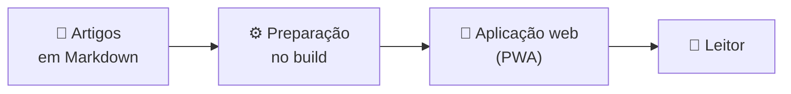

<div align="center">


# 📚 SST FAQ — Base de Conhecimento

**O conhecimento do time sobre Saúde e Segurança do Trabalho, reunido em um só lugar, com busca rápida.**


</div>

---

## 📌 O que é este projeto?

O **SST FAQ** é um portal de consulta que reúne a documentação interna de uma equipe sobre **Saúde e Segurança do Trabalho (SST)**: eventos do eSocial (S-2210, S-2220 e S-2240), Normas Regulamentadoras (NRs) e rotinas previdenciárias.

Em vez de depender de explicações orais ou de arquivos espalhados, o time encontra a resposta em um único lugar, pesquisando por termo ou navegando pelos artigos.

<!-- 
> **Nota:** esta é uma documentação de apresentação. Os detalhes técnicos serão detalhados em uma etapa posterior, após a validação contra o código-fonte.
-->

---

## 📖 A origem do projeto

A **Base de Conhecimento** nasceu de uma dor operacional que percebi nos meus primeiros meses de estágio. Em uma software house em franco crescimento, a cultura e os processos eram transmitidos quase exclusivamente de forma oral.

### 🔊 O problema

Sem um lugar único para consultar, o conhecimento ficava na cabeça das pessoas. Isso gerava:

- ruídos de comunicação entre os membros do time;
- impacto nos tempos de resposta (SLA);
- dificuldade para integrar novos colaboradores.

### 🧭 A iniciativa

Ao identificar essa barreira, tomei a iniciativa de documentar e mapear os fluxos de trabalho. A otimização foi tão expressiva que impulsionou a minha promoção à liderança da equipe de treinamento.

### 🤝 Do documento ao portal

A partir daí, passamos a documentar o conhecimento de forma colaborativa com o time. O volume de material gerado foi tão rico que exigiu a criação de um portal centralizado, e é aí que nasce o SST FAQ.

### 💭 A ideia por trás do portal

- **Conteúdo como código:** os artigos são arquivos Markdown versionados no Git, com histórico de todas as alterações.
- **Sem infraestrutura complexa:** a leitura dos artigos não depende de um banco de dados complexo.
- **Consulta em qualquer lugar:** a aplicação funciona em qualquer dispositivo e pode ser instalada como aplicativo.
- **Resposta rápida:** uma busca local, que tolera erros de digitação, leva o time ao artigo certo.

### 🌟 Hoje

A plataforma é o coração operacional da equipe. Ela centraliza as orientações de SST, apoia o onboarding e contribui para reduzir erros e a rotatividade (*turnover*) do time.

> Idealizado e arquitetado por mim, com a parceria essencial de [Guilherme Cruz](https://github.com/https-shini), no apoio ao desenvolvimento, e de [João Sanches](https://github.com/Juao-crtl-c), na curadoria minuciosa do conteúdo. Conheça a equipe em [Créditos](#-créditos).

---

## ✨ Principais funcionalidades

- 🔎 **Busca tolerante a erros**  
  Pesquisa local com índice pré-compilado, que aceita erros de digitação e acentuação.

- ⌨️ **Navegação por teclado**  
  Command palette global acionada por `Ctrl+K` / `Cmd+K`.

- 📖 **Leitura confortável**  
  Artigos em Markdown, com tipografia própria e tooltips de glossário inseridos automaticamente (o mecanismo existe, mas o glossário, `src/data/glossary.json`, ainda está vazio).

- 📋 **Fila de leitura**  
  Página dedicada (`/minha-lista`) para organizar o que ler.

- 🌗 **Tema claro e escuro**  
  Alternância global aplicada a textos, bordas e fundos.

- 📲 **Instalável como aplicativo**  
  Manifest PWA para instalação. Ainda não há service worker, portanto não há cache offline.

- 🔗 **Links com pré-visualização**  
  Metadados OpenGraph e Twitter Cards para compartilhar artigos.

- 👤 **Contas e papéis**  
  Cadastro, login, recuperação de senha e login social, com os papéis Administrador, Editor e Leitor verificados no servidor.

- 💬 **Interações nos artigos**  
  Avaliações, sugestões de correção e comentários, com moderação por editores e administradores.

- 🛠️ **Área administrativa**  
  Painel, editor de artigos, pedidos de acesso de editor e gestão de usuários.

- ♿ **Acessibilidade**  
  Tags semânticas e uso do teclado (Enter, Espaço e Esc).

---

## 🧭 Como é a experiência de uso

1. **Acessar** o portal, no computador ou no celular.
2. **Buscar** um assunto digitando na busca ou abrindo a command palette com `Ctrl+K`.
3. **Ler** o artigo, com termos técnicos explicados por tooltips de glossário.
4. **Continuar** por artigos relacionados ou pelo próximo da sequência.
5. **Guardar** o que ficou para depois na fila de leitura.

<!-- TODO: adicionar screenshots da interface em uma seção "🖼️ Interface" quando as imagens estiverem disponíveis no repositório. -->

---

## 💼 Casos de uso

| Situação | Como o portal ajuda |
| :-- | :-- |
| 🧑‍🎓 **Onboarding** | Novos colaboradores consultam processos e normas por conta própria, sem depender de explicação oral. |
| ⚡ **Dúvida do dia a dia** | O time busca um evento do eSocial ou uma NR e chega ao artigo em poucos passos. |
| ✍️ **Manutenção do conteúdo** | Quem cuida da documentação edita e organiza os artigos pela área administrativa. |

---

## 🧩 Como o projeto funciona?

Os artigos são escritos em **Markdown** e versionados no Git (abordagem *content as code*). O conteúdo é preparado durante o build e carregado no navegador apenas quando o leitor abre cada artigo, sem depender de um banco de dados complexo.



O login, o cadastro e os papéis (Administrador, Editor e Leitor) vêm de um serviço separado, o **AuthService**. A organização do código, os fluxos e as convenções estão em [docs/ARQUITETURA.md](./docs/ARQUITETURA.md).

---

## 👥 Para quem é?

- **Equipes** que precisam de uma fonte única de consulta sobre SST, eSocial e rotinas previdenciárias.
- **Novos colaboradores**, que precisam se localizar rápido em processos e normas.
- **Responsáveis pelo conteúdo**, que mantêm a documentação atualizada.

---

## 🛠️ Tecnologias principais

Versões conforme o `package.json`.

| Tecnologia | Utilização |
| :-- | :-- |
| **Next.js 16** (App Router), **React 19** e **TypeScript 5.8** | Aplicação, renderização no servidor e tipagem |
| **Tailwind CSS 4.1** | Estilos e tema claro/escuro |
| **MiniSearch** | Busca local |
| **Marked**, **sanitize-html** e **Gray-Matter** | Leitura e sanitização do Markdown |
| **CMDK** e **GSAP** | Command palette e animações |
| **Mermaid** | Diagramas dentro dos artigos |
| **Sentry** | Monitoramento de erros, só depois do consentimento |
| **jose** | Validação do token de acesso emitido pelo AuthService |
| **Manifest PWA** | Instalação como aplicativo (não há service worker nem cache offline) |
| **Vitest**, **Testing Library** e **Playwright** | Testes unitários e E2E |

---

## 🚀 Como executar

**Pré-requisitos:** [Node.js](https://nodejs.org/) e npm.

```bash
git clone https://github.com/VictorCardosoOl/Base_de_Conhecimento.git
cd Base_de_Conhecimento/BaseCore
npm ci
npm run dev
```

O endereço local é exibido no terminal ao iniciar o servidor.

Para rodar com login, cadastro e painel administrativo (AuthService + Docker), configure uma vez seguindo [docs/RODANDO_LOCALMENTE.md](./docs/RODANDO_LOCALMENTE.md); depois, um comando sobe tudo:

```bash
npm run dev:all
```

Para gerar a versão de produção:

```bash
npm run build
```

---

## ⚙️ Para quem desenvolve

A BaseCore é o site: artigos, busca, leitura, Minha conta e o painel administrativo. Contas, sessões,
papéis e as interações dos artigos (avaliações, sugestões e comentários) vêm do
[AuthService](../AuthService). Como os dois se falam: [`docs/AUTENTICACAO.md`](../docs/AUTENTICACAO.md).

**Versão do Node:** 22 (CI e Docker), testado também com 24.11.

### Variáveis de ambiente

Copie `.env.example` para `.env.local` (não versionado). Todas ficam só no servidor, exceto as com
prefixo `NEXT_PUBLIC_`.

| Variável | Obrigatória | Exemplo | Onde é usada |
| --- | --- | --- | --- |
| `AUTH_INTERNAL_URL` | para login e conta | `http://localhost:8010` | rewrites `/auth/*` e `/content/*` (fixados no build) e chamadas do servidor ao AuthService |
| `AUTH_ISSUER` | com `AUTH_INTERNAL_URL` | `http://localhost:8010` | validação do access token; igual a `JWT_ISSUER` do AuthService |
| `AUTH_AUDIENCE` | com `AUTH_INTERNAL_URL` | `knowledge-api` | validação do access token; igual a `JWT_AUDIENCE` |
| `AUTH_ACCESS_COOKIE_NAME` | com `AUTH_INTERNAL_URL` | `kb_at` | leitura do cookie de sessão; igual a `ACCESS_COOKIE_NAME` |
| `AUTH_JWKS_URL` | não | `http://localhost:8010/.well-known/jwks.json` | chaves públicas; padrão: `<AUTH_INTERNAL_URL>/.well-known/jwks.json` |
| `NEXT_PUBLIC_SENTRY_DSN` | não | `https://chave-ficticia@sentry.exemplo.com/1` | monitoramento de erros, ativado só com consentimento |
| `NEXT_PUBLIC_APP_VERSION` | não | `2.0.0` | versão enviada ao Sentry |
| `E2E_*` | só para E2E | `leitor@exemplo.test` | contas de teste do Playwright, em `.env.e2e.local` |

Sem as variáveis `AUTH_*`, o `npm run dev` e o `npm run build` funcionam: o site abre para leitura e login,
conta e painel ficam indisponíveis, sem conceder acesso. As rotas protegidas leem a configuração só em tempo
de requisição. Os rewrites `/auth/*` e `/content/*`, porém, são fixados no build: um build feito sem
`AUTH_INTERNAL_URL` continua sem login mesmo que a variável seja definida depois, até ser construído de novo.

### Comandos

| Comando | O que faz |
| --- | --- |
| `npm run dev` | servidor de desenvolvimento em http://localhost:3000 (gera o catálogo antes) |
| `npm run dev:all` | sobe o AuthService (Docker) e depois o `npm run dev` |
| `npm run auth:up`, `auth:stop`, `auth:status`, `auth:logs` | controlam o AuthService pelo compose da pasta `../AuthService` |
| `npm run start:all` e `npm run stop:all` | sobem o AuthService e a BaseCore em modo de produção; param o AuthService |
| `npm run build` e `npm run start` | build de produção e servidor de produção na porta 3000 |
| `npm run catalog` | gera `src/data/catalog.json` e `src/data/mapping.ts` a partir dos artigos |
| `npm run lint`, `npm run typecheck`, `npm test` | ESLint, TypeScript e Vitest; `npm run check` roda os três |
| `npm run test:coverage` | Vitest com cobertura (mínimo de 70%) |
| `npm run test:e2e` | Playwright contra a Base e o AuthService no ar |
| `npm run lint:md` e `npm run format:check` | markdownlint dos artigos e verificação do Prettier (fora do CI; ver [CONTRIBUTING.md](../CONTRIBUTING.md)). No Windows, o `lint:md` não expande o glob: use `npx markdownlint --config .markdownlint.json "src/content/artigos/**/*.md"` |

Para subir tudo em containers, use o `docker-compose.yml` da raiz do repositório
([README da raiz](../README.md)). Guia completo do ambiente local:
[`docs/RODANDO_LOCALMENTE.md`](./docs/RODANDO_LOCALMENTE.md). Testes: [`docs/TESTES.md`](../docs/TESTES.md).

---

## 🗺️ Rotas principais

| Rota | O que é |
| :-- | :-- |
| `/` | Início, com listagem de artigos e busca |
| `/minha-lista` | Trilhas e fila de leitura |
| `/artigo/:id` | Acesso direto a um artigo |
| `/sobre` | Sobre o projeto |
| `/login` · `/cadastro` | Entrar e criar conta (a conta nasce como Leitor) |
| `/conta` · `/conta/senha` | Minha conta, pedido de acesso de editor e troca de senha |
| `/admin` · `/admin/editor` | Painel e editor de artigos (Administrador e Editor) |
| `/admin/solicitacoes` | Pedidos de acesso de editor (Administrador e Editor) |
| `/admin/usuarios` | Gestão de usuários (Administrador) |

### 🔐 Acesso e perfis

A autenticação é feita pelo [AuthService](../AuthService), na pasta `AuthService/` deste repositório. Não há credenciais embutidas na aplicação.
Perfis: **Administrador**, **Editor** e **Leitor**; o papel e o status da conta são verificados no servidor a cada acesso.
Como funciona: [`docs/AUTENTICACAO.md`](../docs/AUTENTICACAO.md). Histórico da integração: [`docs/INTEGRACAO_AUTH.md`](./docs/INTEGRACAO_AUTH.md).

---

## 🤝 Contribuição

Contribuições são bem-vindas, seja para melhorar o conteúdo, corrigir um erro ou evoluir a aplicação.

### Formas de contribuir

| Tipo | Exemplos |
| :-- | :-- |
| 📝 **Conteúdo** | Criar um artigo, atualizar uma orientação, corrigir um texto ou termo do glossário |
| 🐛 **Correções** | Reportar ou corrigir um problema encontrado durante o uso |
| 💡 **Melhorias** | Sugerir ou implementar ajustes de interface, acessibilidade ou usabilidade |

### Passo a passo

1. **Faça um fork** do repositório e clone-o na sua máquina.
2. **Crie uma branch** para a sua alteração, com um nome que descreva o objetivo:

   ```bash
   git checkout -b minha-contribuicao
   ```

3. **Faça as alterações.** Os artigos são arquivos Markdown, processados durante o build pelo script `scripts/generate-catalog.js`.
4. **Valide localmente** com o ambiente de desenvolvimento e confira se o resultado aparece como esperado:

   ```bash
   npm ci
   npm run dev
   ```

5. **Faça o commit** com uma mensagem curta e clara sobre o que mudou (padrão em [CONTRIBUTING.md](../CONTRIBUTING.md)).
6. **Envie a branch** e **abra um Pull Request** descrevendo o que foi alterado e por quê.

> **Dica:** em alterações de conteúdo, descreva no Pull Request qual artigo foi criado ou modificado. Isso facilita a revisão.

Guia completo de contribuição (branches, commits, testes e segredos): [CONTRIBUTING.md](../CONTRIBUTING.md). Para artigos: [`docs/INSERCAO_ARTIGOS.md`](./docs/INSERCAO_ARTIGOS.md).

---

## 👏 Créditos

O SST FAQ não é obra de uma pessoa só. Ele existe porque alguém quis resolver um problema real, outros se juntaram para construir a solução e o time inteiro ajudou a transformar o dia a dia em documentação.

### 👥 Equipe

<table align="center">
  <tr>
    <td align="center" width="260">
      <a href="https://github.com/VictorCardosoOl">
        
      </a>
      <br /><br />
      <strong>Victor Cardoso Cunha</strong>
      <br />
      <sub>Idealização e arquitetura</sub>
      <br /><br />
      <sub>Identificou o problema, iniciou a documentação dos fluxos de trabalho e projetou o portal.</sub>
      <br /><br />
      <a href="https://github.com/VictorCardosoOl">GitHub</a> ·
      <a href="https://linkedin.com/in/victorcardosocunha">LinkedIn</a>
    </td>
    <td align="center" width="260">
      <a href="https://github.com/https-shini">
        
      </a>
      <br /><br />
      <strong>Guilherme Cruz</strong>
      <br />
      <sub>Desenvolvimento</sub>
      <br /><br />
      <sub>Apoiou a construção da aplicação ao longo do desenvolvimento.</sub>
      <br /><br />
      <a href="https://gcruz.dev.br">Portfólio</a> ·
      <a href="https://github.com/https-shini">GitHub</a>
    </td>
    <td align="center" width="260">
      <a href="https://github.com/Juao-crtl-c">
        
      </a>
      <br /><br />
      <strong>João Sanches</strong>
      <br />
      <sub>Curadoria de conteúdo</sub>
      <br /><br />
      <sub>Revisou e organizou o material técnico publicado no portal.</sub>
      <br /><br />
      <a href="https://github.com/Juao-crtl-c">GitHub</a>
    </td>
  </tr>
</table>

### 🌱 Como tudo começou

| Etapa | O que aconteceu |
| :-- | :-- |
| **1. Percepção** | Nos primeiros meses de estágio, Victor notou que processos e cultura da equipe passavam quase só pela comunicação oral. |
| **2. Iniciativa** | Ele começou a documentar e mapear os fluxos de trabalho, o que impulsionou sua ida para a liderança da equipe de treinamento. |
| **3. Colaboração** | O time passou a documentar o conhecimento em conjunto, e o volume de material justificou um portal próprio. |
| **4. Portal** | O SST FAQ nasceu para centralizar esse conhecimento e servir de apoio à rotina da equipe. |

### 🙏 Agradecimentos

- Ao **time da software house**, que participou da documentação colaborativa e deu origem ao conteúdo publicado no portal.
- Aos **mantenedores dos projetos de código aberto** que sustentam a aplicação, listados em [Tecnologias principais](#️-tecnologias-principais).
- A **quem contribui** com artigos, correções e sugestões, conforme descrito em [Contribuição](#-contribuição).

### 📬 Contato

Dúvidas, sugestões ou propostas de colaboração:

[](https://linkedin.com/in/victorcardosocunha)
<br>
[](https://github.com/VictorCardosoOl)

---

<div align="center">

Feito com 💚: conhecimento do time simples de encontrar.

⭐ Se gostou, deixe uma estrela no repositório!


</div>
