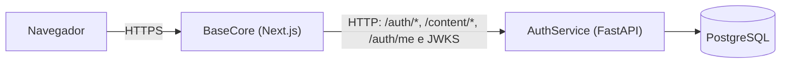

# Base de Conhecimento SST

Portal de consulta que reúne o conhecimento de uma equipe sobre Saúde e Segurança do Trabalho (SST): eventos
do eSocial, Normas Regulamentadoras e rotinas previdenciárias, com busca rápida e leitura offline. Na versão
2.0.0, ganhou contas, papéis e interações nos artigos (avaliações, sugestões de correção e comentários), com
um serviço de identidade próprio.

[-blue)](./LICENSE)
[-blue)](./AuthService/read-model/LICENSE)

**Comece por aqui:**

- [Como rodar](#início-rápido)
- [Como a autenticação funciona](./docs/AUTENTICACAO.md)
- [Como contribuir](./CONTRIBUTING.md)

## Propósito

O projeto nasceu de uma dor operacional observada por [Victor Cardoso Cunha](https://github.com/VictorCardosoOl)
numa software house em que processos e cultura passavam quase só pela comunicação oral: ruídos entre o time,
impacto nos tempos de resposta e dificuldade para integrar novos colaboradores. A documentação colaborativa
dos fluxos de trabalho cresceu até exigir um portal próprio, o SST FAQ. A história completa está no
[README da BaseCore](./BaseCore/README.md#-a-origem-do-projeto).

Para quem é:

- equipes que precisam de uma fonte única de consulta sobre SST, eSocial e rotinas previdenciárias;
- novos colaboradores, que precisam se localizar rápido em processos e normas;
- responsáveis pelo conteúdo, que mantêm a documentação atualizada.

Os artigos são Markdown versionado no Git (conteúdo como código). O repositório tem fins de estudo e
demonstração de arquitetura: os conteúdos de SST e eSocial podem estar desatualizados ou não ser oficiais
(nota educacional do [LICENSE](./LICENSE)).

## Arquitetura



- O navegador fala só com a BaseCore. Ela repassa `/auth/*` e `/content/*` ao AuthService na mesma origem e
  consulta `/auth/me` e o JWKS no servidor para validar a sessão.
- O AuthService é a fonte da verdade para contas, sessões, papéis e interações dos artigos. Só ele tem banco.
- Os artigos ficam dentro da BaseCore, em `BaseCore/src/content/artigos/`.

Decisões de arquitetura: [docs/adr/README.md](./docs/adr/README.md).

## Pastas

| Pasta | Conteúdo | Documentação |
| --- | --- | --- |
| [`BaseCore/`](./BaseCore) | Site (Next.js): artigos, busca, leitura, Minha conta e painel administrativo | [README](./BaseCore/README.md) |
| [`AuthService/`](./AuthService) | Identidade e interações (FastAPI e PostgreSQL) | [README](./AuthService/README.md) |
| [`deploy/`](./deploy) | Exemplos de proxy de borda (Caddy e Nginx) | [IMPLANTACAO.md](./AuthService/docs/IMPLANTACAO.md) |
| [`docs/`](./docs) | Documentação geral e ADRs do projeto inteiro | [índice](./docs/README.md) |
| `.github/` | CI por serviço, CodeQL e Dependabot | [CONTRIBUTING.md](./CONTRIBUTING.md#ci) |
| raiz | `docker-compose.yml`, `render.yaml`, CHANGELOG, guias de contribuição e licença | esta página |

## Início rápido

Pré-requisitos: Git, Docker Desktop aberto e Python 3.11 ou mais novo (para gerar as chaves). Para
desenvolver a BaseCore fora do Docker, Node.js 22.

### Primeira vez

Na pasta `AuthService/`:

```bash
cp .env.example .env
python -m backend.scripts.generate_keys
```

No `AuthService/.env`, troque a senha de exemplo do banco local em `POSTGRES_PASSWORD` e repita a mesma
senha dentro do `DATABASE_URL`. Os demais valores servem para desenvolvimento, inclusive as contas de teste
criadas pelo seed (`SEED_*`). Nunca versione o `.env` nem a pasta `keys/`.

### Tudo junto, em containers

Na raiz:

```bash
docker compose up -d --build
```

| Serviço | Endereço local |
| --- | --- |
| BaseCore | http://localhost:3000 |
| AuthService | http://localhost:8010 |
| Mailpit (emails de desenvolvimento) | http://localhost:8025 |

Para parar mantendo os dados: `docker compose stop`.

### Cada serviço isolado

| O que rodar | Como | Guia |
| --- | --- | --- |
| Só o AuthService | `docker compose up -d --build` na pasta `AuthService/` | [AuthService/README.md](./AuthService/README.md) |
| BaseCore em desenvolvimento, com login | na pasta `BaseCore/`: copie `.env.example` para `.env.local`, rode `npm ci` e `npm run dev:all` | [RODANDO_LOCALMENTE.md](./BaseCore/docs/RODANDO_LOCALMENTE.md) |
| Só a BaseCore, sem login | na pasta `BaseCore/`, sem `.env.local`: `npm ci` e `npm run dev` | [BaseCore/README.md](./BaseCore/README.md) |

Sem as variáveis `AUTH_*`, a BaseCore abre os artigos normalmente; login, conta e painel ficam indisponíveis
e não concedem acesso. As variáveis essenciais de cada serviço estão nas tabelas dos READMEs:
[BaseCore](./BaseCore/README.md) e [AuthService](./AuthService/README.md).

Algo deu errado? [docs/SOLUCAO_DE_PROBLEMAS.md](./docs/SOLUCAO_DE_PROBLEMAS.md).

## Testes

| Serviço | Comandos, na pasta do serviço |
| --- | --- |
| BaseCore | `npm run lint`, `npm run typecheck`, `npm test`, `npm run build`, `npm run test:e2e` |
| AuthService | `ruff check backend migrations tests`, `mypy`, `pytest` (precisa de um PostgreSQL de teste) |

O que cada suíte cobre, como preparar o banco de teste e o E2E e as instabilidades conhecidas:
[docs/TESTES.md](./docs/TESTES.md).

## Segurança

- **Autenticação:** access token JWT EdDSA validado pelo JWKS e confirmado no AuthService a cada acesso;
  refresh token opaco e rotativo; senhas com Argon2id.
- **Cookies:** `HttpOnly`, `SameSite=Lax` e `Secure` em produção; o refresh token só vai a `/auth`.
- **Limites de tentativas:** por IP, por IP e email e por conta, contando só as falhas de login.
- **CSRF e cabeçalhos:** escritas exigem `Origin` confiável; a BaseCore envia CSP, `X-Frame-Options`,
  `X-Content-Type-Options`, `Referrer-Policy`, `Permissions-Policy` e, em produção, HSTS.
- **Segredos:** só em `.env` e no painel da hospedagem, nunca no Git; o CI procura segredos versionados.

Referência completa: [docs/AUTENTICACAO.md](./docs/AUTENTICACAO.md). Regras de segredos:
[CONTRIBUTING.md](./CONTRIBUTING.md#segredos).

## Implantação

O deploy na Render, no plano gratuito, está em validação, a partir da branch de trabalho: passo a passo,
limites e reversão em [docs/DEPLOY.md](./docs/DEPLOY.md). O comportamento do proxy da hospedagem ainda não
foi medido. Checklist de produção do AuthService: [IMPLANTACAO.md](./AuthService/docs/IMPLANTACAO.md).

## Documentação

| Assunto | Documento |
| --- | --- |
| Índice completo | [docs/README.md](./docs/README.md) |
| Autenticação | [docs/AUTENTICACAO.md](./docs/AUTENTICACAO.md) |
| Testes | [docs/TESTES.md](./docs/TESTES.md) |
| Solução de problemas | [docs/SOLUCAO_DE_PROBLEMAS.md](./docs/SOLUCAO_DE_PROBLEMAS.md) |
| Glossário | [docs/GLOSSARIO.md](./docs/GLOSSARIO.md) |
| Inserção de artigos | [BaseCore/docs/INSERCAO_ARTIGOS.md](./BaseCore/docs/INSERCAO_ARTIGOS.md) |

## Contribuição e colaboradores

- Como contribuir (branches, commits, testes, CI e segredos): [CONTRIBUTING.md](./CONTRIBUTING.md).
- Quem participa do projeto e as origens que recebem crédito: [CONTRIBUTORS.md](./CONTRIBUTORS.md).

## Licenças

A licença de cada pasta vale para essa pasta:

| Escopo | Licença |
| --- | --- |
| Repositório, inclusive a BaseCore, exceto `AuthService/` | [LICENSE](./LICENSE): MIT (Educational & Study Use), Copyright (c) 2026 Victor Cardoso, com nota educacional |
| `AuthService/` | [AuthService/read-model/LICENSE](./AuthService/read-model/LICENSE): MIT, Copyright (c) 2024 Guilherme Souza |

## Estado e pendências

Mudanças da versão 2.0.0, riscos conhecidos e pendências: [CHANGELOG.md](./CHANGELOG.md).
