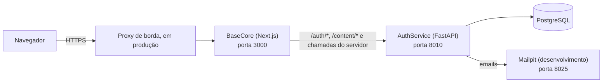

# Base SST

Base de conhecimento de Saúde e Segurança do Trabalho (SST), com contas, papéis e interações nos artigos
(avaliações, sugestões de correção e comentários). Este repositório reúne os dois serviços do projeto.

**Comece por aqui:**

- [Como rodar](#como-rodar)
- [Como a autenticação funciona](./docs/AUTENTICACAO.md)
- [Como contribuir](./CONTRIBUTING.md)

## Arquitetura



- O navegador fala só com a BaseCore; ela repassa `/auth/*` e `/content/*` ao AuthService, na mesma
  origem. Detalhes em [docs/AUTENTICACAO.md](./docs/AUTENTICACAO.md).
- O AuthService é a fonte da verdade para contas, sessões, papéis e interações dos artigos.
- Os artigos são arquivos Markdown dentro da BaseCore (`BaseCore/src/content/artigos/`).

## Pastas

| Pasta | O que é | Documentação |
| --- | --- | --- |
| [`BaseCore/`](./BaseCore) | Site da Base de Conhecimento (Next.js): artigos, busca, leitura, Minha conta e painel administrativo | [BaseCore/README.md](./BaseCore/README.md) |
| [`AuthService/`](./AuthService) | Serviço de identidade e de interações (FastAPI e PostgreSQL) | [AuthService/README.md](./AuthService/README.md) |
| [`deploy/`](./deploy) | Exemplos de proxy de borda (Caddy e Nginx) para produção | [AuthService/docs/IMPLANTACAO.md](./AuthService/docs/IMPLANTACAO.md) |
| [`docs/`](./docs) | Documentação que vale para o projeto inteiro e ADRs gerais | [docs/README.md](./docs/README.md) |
| `.github/workflows/` | CI de cada serviço, com filtro por pasta | [CONTRIBUTING.md](./CONTRIBUTING.md#ci) |

## Como rodar

Pré-requisitos: Git, Docker Desktop (aberto) e Python 3.11 ou mais novo (só para gerar as chaves). Para
desenvolver a BaseCore fora do Docker, Node.js 22 (CI e Docker), testado também com 24.11.

### Primeira vez

Na pasta `AuthService/`:

```bash
cp .env.example .env
python -m backend.scripts.generate_keys
```

No `AuthService/.env`, ajuste:

| Variável | Valor | Por quê |
| --- | --- | --- |
| `POSTGRES_PASSWORD` | uma senha sua, só para o banco local | o exemplo vem com um valor a trocar |
| `DATABASE_URL` | a mesma senha dentro da URL | o serviço usa essa URL |

Os demais valores do exemplo servem para desenvolvimento, incluindo `AUTH_PORT=8010` e
`JWT_ISSUER=http://localhost:8010` (o que a BaseCore espera) e `SEED_DEV_USERS=true`, que cria contas
de teste (administrador, editor e leitor) com as credenciais `SEED_*` do próprio `.env`.

### Tudo junto, em containers

Na raiz:

```bash
docker compose up -d --build
```

| Serviço | Endereço |
| --- | --- |
| Base de Conhecimento | http://localhost:3000 |
| AuthService | http://localhost:8010 |
| Mailpit (emails de desenvolvimento) | http://localhost:8025 |

Para parar mantendo os dados: `docker compose down` (o banco só é apagado com `down -v`).

### Separados

- **Só o AuthService:** `docker compose up -d --build` na pasta `AuthService/`
  ([AuthService/README.md](./AuthService/README.md)).
- **BaseCore em modo de desenvolvimento** (recarga automática), com o AuthService em container: na pasta
  `BaseCore/`, copie `.env.example` para `.env.local`, rode `npm ci` e `npm run dev:all`. Passo a passo em
  [BaseCore/docs/RODANDO_LOCALMENTE.md](./BaseCore/docs/RODANDO_LOCALMENTE.md).
- **Só a BaseCore, sem login:** `npm ci` e `npm run dev` na pasta `BaseCore/`, sem `.env.local`. Os artigos
  abrem normalmente; login, conta e painel respondem "indisponível" e não concedem acesso. O `npm run build`
  também passa sem as variáveis `AUTH_*` (como no CI), mas gera um site sem login: os rewrites para o
  AuthService são fixados no build. Para ter login, defina as variáveis antes de construir.

Algo deu errado? [docs/SOLUCAO_DE_PROBLEMAS.md](./docs/SOLUCAO_DE_PROBLEMAS.md).

## Como testar

| Serviço | Comandos (na pasta do serviço) |
| --- | --- |
| BaseCore | `npm run lint`, `npm run typecheck`, `npm test`, `npm run build`, `npm run test:e2e` |
| AuthService | `ruff check backend migrations tests`, `mypy`, `pytest` (precisa de um PostgreSQL de teste) |

O que cada suíte cobre, como rodar o E2E com os dois serviços e as instabilidades conhecidas:
[docs/TESTES.md](./docs/TESTES.md).

## Implantação

Checklist de produção, proxy de borda, `TRUSTED_PROXY_COUNT`, limpeza periódica e o roteiro de medição do
primeiro deploy: [AuthService/docs/IMPLANTACAO.md](./AuthService/docs/IMPLANTACAO.md).

## Documentação

Índice completo em [docs/README.md](./docs/README.md). Decisões de arquitetura em
[docs/adr/README.md](./docs/adr/README.md). Termos em [docs/GLOSSARIO.md](./docs/GLOSSARIO.md). Mudanças
por versão em [CHANGELOG.md](./CHANGELOG.md).

## Licenças

Cada pasta segue a própria licença:

- A Base de Conhecimento e o restante do repositório: [LICENSE](./LICENSE) (MIT, uso educacional e de
  estudo).
- O AuthService (`AuthService/`): [AuthService/read-model/LICENSE](./AuthService/read-model/LICENSE) (MIT).
