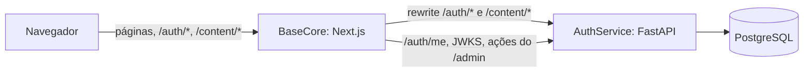

# Autenticação

Referência única de como contas, sessões e permissões funcionam na Base SST. Os detalhes de cada
decisão estão nos ADRs (`AuthService/docs/adr/`); o histórico da integração está em
[`BaseCore/docs/INTEGRACAO_AUTH.md`](../BaseCore/docs/INTEGRACAO_AUTH.md).

## Peças

- O navegador fala só com a BaseCore (mesma origem). A BaseCore repassa `/auth/*` e `/content/*` ao
  AuthService. Os cookies são do próprio site e não há CORS.
- O AuthService é a fonte da verdade para identidade, papel, status da conta e sessão.
- `/admin/*` são páginas da BaseCore. A API administrativa do AuthService (`/admin/users`,
  `/admin/role-requests`) é chamada pelo servidor da BaseCore, nunca pelo navegador.

## Cookies

| Cookie | Nome em desenvolvimento | Nome em produção | Caminho | Atributos |
| --- | --- | --- | --- | --- |
| Access token | `kb_at` | `__Host-kb_at` | `/` | `HttpOnly`, `SameSite=Lax`, validade de 10 min |
| Refresh token | `kb_rt` | `__Secure-kb_rt` | `/auth` | `HttpOnly`, `SameSite=Lax`, validade de 7 dias |

- Em produção os dois são `Secure` (o AuthService recusa subir com `COOKIE_SECURE=false`).
- Nenhum token fica em `localStorage`, `sessionStorage` ou ao alcance do JavaScript.
- O `kb_rt` só é enviado para `/auth/*`. Por isso o servidor da BaseCore nunca o vê nas páginas: a
  renovação sempre parte do navegador.
- `AUTH_ACCESS_COOKIE_NAME` da BaseCore precisa ser igual a `ACCESS_COOKIE_NAME` do AuthService.

## Login

1. A tela de login envia `POST /auth/login` com email e senha.
2. O AuthService consulta os limites de tentativas (seção "Limites de tentativas"). Se algum estiver
   esgotado, responde `429` com `Retry-After`, mesmo que a senha esteja correta.
3. Confere a senha (Argon2id). Email inexistente, conta sem senha, senha errada e conta inativa dão a
   mesma resposta, `401 INVALID_CREDENTIALS`, e o mesmo custo de tempo.
4. Se der certo, abre uma sessão no banco e grava os dois cookies.
5. A tela volta para o destino pedido (`?next=`). Se a conta tem senha temporária, vai antes para a troca
   de senha.

## Sessão e renovação

| Item | Valor padrão | Variável |
| --- | --- | --- |
| Validade do access token | 10 min | `ACCESS_TOKEN_TTL_SECONDS` |
| Validade do refresh token | 7 dias | `REFRESH_TOKEN_TTL_SECONDS` |
| Duração máxima da sessão | 30 dias | `SESSION_MAX_LIFETIME_SECONDS` |
| Tolerância para abas renovando juntas | 10 s | `REFRESH_REUSE_GRACE_SECONDS` |

- **Access token:** JWT assinado com EdDSA (chave pública em `/.well-known/jwks.json`), com o usuário,
  o papel e a sessão (`sid`).
- **Refresh rotativo:** cada `POST /auth/refresh` troca o refresh token por um novo. Reapresentar um
  refresh token já usado dentro da tolerância é tratado como abas concorrentes; fora dela, é reuso: a
  sessão inteira é revogada e a resposta é `401`.
- **Access vencido:** a API responde `401 SESSION_EXPIRED`. O cliente da BaseCore (`authFetch`) renova
  uma vez e repete a requisição.
- **Página aberta com o access vencido ou ausente:** a página manda para o login, que renova em
  silêncio ("Verificando sessão…") e volta ao destino. Um detector de loop interrompe a volta se o
  servidor recusar a sessão de novo (por exemplo, nome de cookie divergente), e a tela mostra
  "Não foi possível manter a sessão neste navegador". A marca de volta é apagada quando o destino abre
  com sessão válida, então uma volta legítima logo depois não é confundida com loop.

## Proteção das páginas da BaseCore

1. `src/proxy.ts` faz uma checagem rápida em `/admin` e `/conta`: sem o cookie de access, vai direto
   para o login. Não é autorização.
2. A página chama `requireSession()` ou `requireRole()` no servidor: valida o JWT pelo JWKS e consulta
   `GET /auth/me`, que confere no banco a sessão, o status da conta e o papel atual. O papel dentro do
   JWT nunca basta.
3. Esconder links no menu é só conveniência visual.

## Papéis

| Papel | Nome na tela | Painel `/admin` e editor | Solicitações de editor | Usuários `/admin/usuarios` | Moderação de comentários e sugestões |
| --- | --- | --- | --- | --- | --- |
| `admin` | Administrador | sim | sim | sim | sim |
| `editor` | Editor | sim | sim | não (403) | sim |
| `user` | Leitor | não (403) | não (403) | não (403) | não |

- Toda conta acessa "Minha conta" (`/conta`). Um leitor pode pedir acesso de editor; um editor ou
  administrador aprova.
- O cadastro público cria sempre o papel `user`.

## Senha temporária

- Contas criadas por um administrador, ou com senha redefinida por ele, nascem com
  `must_change_password=true`.
- Depois do login, a BaseCore manda para `/conta/senha` antes de liberar o resto.
- O AuthService impõe a mesma regra: enquanto a troca estiver pendente, as escritas de `/content`, o
  pedido de editor e a API administrativa respondem `403 PASSWORD_CHANGE_REQUIRED`. Ler, trocar a senha
  e sair continuam liberados.
- Na tela, a mensagem é "Troque a senha temporária em Minha conta antes de continuar."

## Cadastro, confirmação de email e recuperação de senha

- O cadastro público só funciona com `PUBLIC_REGISTRATION_ENABLED=true`.
- Links de recuperação de senha (30 min) e de confirmação de email (24 h) são de uso único e levam o
  token no fragmento da URL (`#token=`), que não vai para logs de servidor.
- `POST /auth/password/forgot` responde `202` sempre, exista ou não a conta.
- Redefinir a senha encerra as sessões abertas.

## Login social (OAuth com PKCE)

- Google e GitHub, ligados só quando `OAUTH_<PROVEDOR>_CLIENT_ID` e `..._CLIENT_SECRET` estão definidos.
  Sem provedor configurado, a tela mostra só email e senha.
- `GET /auth/oauth/<provedor>/start` gera `state` (gravado em cookie e no banco, uso único, 10 min) e o
  par PKCE S256; o retorno confere os dois antes de trocar o código.
- O provedor precisa informar email confirmado. Uma conta local com email ainda não confirmado não é
  vinculada automaticamente, para impedir que alguém crie a conta antes do dono e espere o vínculo.
- Conta nova pelo provedor passa por uma etapa de usuário, nome e aceite dos termos (15 min).

## Saída

| Ação | O que acontece |
| --- | --- |
| "Sair" | `POST /auth/logout` revoga a sessão no banco e apaga os dois cookies |
| "Sair de todos os dispositivos" (Minha conta) | `POST /auth/logout-all` revoga todas as sessões da conta, inclusive a atual |
| Limpar só o armazenamento do site | Não encerra a sessão: os tokens estão em cookies `HttpOnly` |
| Apagar só o `kb_at` | Não encerra a sessão: o login renova com o `kb_rt` e volta ao destino |
| Apagar todos os cookies do site | Encerra neste navegador, mas a sessão continua válida no banco até vencer |

## Proxy `/auth` e `/content` e CSRF

- `next.config.ts` cria os rewrites `/auth/:path*` e `/content/:path*` para `AUTH_INTERNAL_URL`. Os
  rewrites são fixados no build da BaseCore.
- O AuthService recusa mutações cujo `Origin` (ou `Referer`) não esteja em `TRUSTED_ORIGINS`, e recusa
  mutação com cookie e sem origem (`403`). O rewrite do Next repassa o `Origin` do navegador.
- As respostas da API saem com `Cache-Control: no-store` e cabeçalhos de segurança próprios.

## Limites de tentativas

Janela fixa, contadores no PostgreSQL (compartilhados entre instâncias). Exceder dá `429 RATE_LIMITED`
com `Retry-After`.

| Ação | Limite padrão | Chave | O que conta |
| --- | --- | --- | --- |
| Login | 30 por minuto | IP | só falhas |
| Login | 5 por minuto | IP + email | só falhas |
| Login | 10 a cada 15 min | conta (email), em qualquer IP | só falhas |
| Troca da própria senha | 5 por minuto | usuário | todas as tentativas |
| Cadastro | 10 por hora | IP | todas |
| Disponibilidade de nome de usuário | 60 por minuto | IP | todas |
| Recuperação de senha | 10 por IP e 3 por email, a cada 15 min | IP e email | todas |
| Uso de link (redefinir senha, confirmar email) | 20 a cada 15 min | IP | todas |
| Reenvio da confirmação de email | 3 a cada 15 min | usuário | todas |
| Login social | 30 a cada 10 min | IP | todas |
| Comentar, editar comentário, sugerir correção, avaliar | 5 a cada 10 min, 20 a cada 10 min, 5 por hora, 30 a cada 10 min | pessoa | todas |

Regras do login:

- **Só as tentativas que falham contam.** O login consulta os três limites sem contar; se nenhum está
  esgotado, confere a senha; só uma falha incrementa os contadores. Um login correto não consome limite.
- **Durante o bloqueio, nem a senha correta passa.**
- O limite por conta vale também para emails inexistentes, para não revelar quais contas existem.
- **Mensagem na tela:** "Muitas tentativas. Tente novamente em 45 s." Acima de 60 s, em minutos
  arredondados para cima ("Tente novamente em 14 min."). O cadastro usa a mesma regra com a frase
  "Muitos cadastros em sequência.".
- Como a janela é fixa, tentativas espalhadas pela virada da janela podem passar um pouco do número.

Riscos aceitos:

- **Bloqueio de uma conta por terceiros:** quem souber um email pode bloquear o login dessa conta por até
  15 minutos errando a senha. A recuperação de senha continua disponível.
- **Corrida não atômica:** consultar e depois contar não são uma operação única. Tentativas simultâneas
  podem passar alguns pontos do limite antes de o bloqueio valer.
- **F1, depende da hospedagem:** atrás do proxy da BaseCore, todas as requisições chegam com o IP do
  proxy. Com `TRUSTED_PROXY_COUNT=0`, o limite por IP vira um limite único para todos: 30 falhas por
  minuto de quaisquer pessoas bloqueiam o login de todos por até 1 minuto. A correção é um proxy de borda
  que sobrescreva o `X-Forwarded-For` e um `TRUSTED_PROXY_COUNT` medido no primeiro deploy
  ([`AuthService/docs/IMPLANTACAO.md`](../AuthService/docs/IMPLANTACAO.md)). O valor do
  `X-Forwarded-For` é validado como IP; um valor inválido é ignorado.

## Erros da API

| Código | HTTP | Quando |
| --- | --- | --- |
| `INVALID_CREDENTIALS` | 401 | email ou senha inválidos (resposta genérica) |
| `UNAUTHORIZED` | 401 | sem sessão ou token inválido |
| `SESSION_EXPIRED` | 401 | access token vencido: renovar e repetir |
| `FORBIDDEN` | 403 | papel sem permissão, ou origem não permitida (CSRF) |
| `PASSWORD_CHANGE_REQUIRED` | 403 | senha temporária ainda não trocada |
| `RATE_LIMITED` | 429 | limite de tentativas, com `Retry-After` |
| `VALIDATION_ERROR` | 400 | dados inválidos |
| `CONFLICT` | 409 | conflito de regra (ex.: email ou usuário já em uso) |

## Onde está no código

| Assunto | AuthService | BaseCore |
| --- | --- | --- |
| Login, refresh, limites | `backend/services/auth_service.py`, `backend/core/rate_limit.py` | `src/app/login/LoginForm.tsx`, `src/features/auth/client.ts` |
| Sessão nas páginas | `backend/dependencies/dependencies.py` | `src/features/auth/session.ts`, `src/proxy.ts` |
| Proteção contra loop no login | | `src/features/auth/return-guard.ts` |
| Login social | `backend/services/oauth_service.py` | `src/features/auth/components/SocialLoginButtons.tsx` |
| Cookies e CSRF | `backend/api/cookies.py`, `backend/api/middleware.py` | `next.config.ts` |

ADRs relacionados: 0002 (JWT EdDSA), 0003 (Argon2id), 0004 e 0008 (refresh e sessões), 0005 (cookies e
CSRF), 0006 e 0016 (limites e IP do cliente), 0009 (papéis e senha temporária), 0012 (recuperação e
confirmação), 0013 (login social). Índice em [`docs/adr/README.md`](./adr/README.md).
